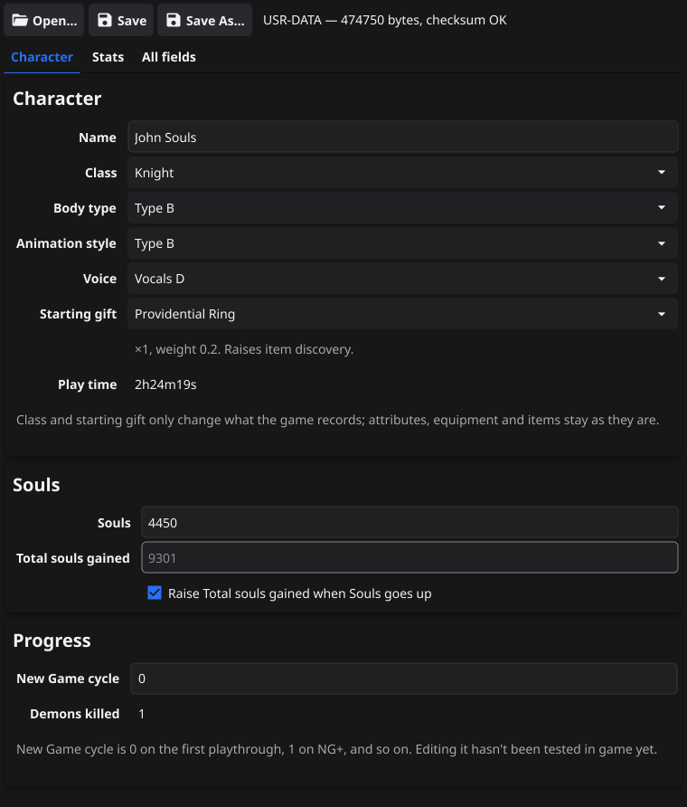

# Demon's Souls Save Editor

[](https://github.com/jsribeiro/des-save-editor/actions/workflows/build.yml)
[](https://github.com/jsribeiro/des-save-editor/releases/latest)
[](LICENSE)

A small, cross-platform save editor for **Demon's Souls (2020)**, the PlayStation 5 remake.
It edits the `USR-DATA` save file: your character's name, souls, attributes, HP, MP and stamina,
or any other field in the file.

<p align="center"></p>

> [!WARNING]
> The save format is still being reverse engineered. Edited souls and attributes have been loaded
> in game successfully, but **always keep a backup of your save** and test edits carefully.

## Features

- **Character**: name, souls and total souls gained, play time.
- **Attributes**: the eight attributes, base and current. By default, changing a base value also
  updates its current value (keeping any equipment bonus) and the attribute total, so the game's
  soul level stays consistent. Values are limited to 1–99, as in game (maximum soul level 712).
- **Souls**: by default, raising your souls raises *total souls gained* by the same amount,
  as gaining souls in game does.
- **HP / MP / Stamina**: base max, current max and current values.
- **All fields**: every record in the file, nested ones included, with a filter. Fields without a
  known name show their key in hex. Any number, true/false or text value can be edited.
- **Safe saving**: every save writes a timestamped backup next to the file first
  (`USR-DATA.20261014-213000.bak`), and the file's lengths and checksum are recalculated automatically.
- A command-line tool, `dessave`, for dumping and scripting edits.

You need the **decrypted** `USR-DATA` file from your save. Getting it off the console and back on
is outside the scope of this project.

## Download

Get the latest build from the [Releases](https://github.com/jsribeiro/des-save-editor/releases/latest) page:

| System | File |
|---|---|
| macOS (Apple Silicon and Intel) | `DeS-Save-Editor-<version>-macos-universal.zip` |
| Windows (64-bit) | `DeS-Save-Editor-<version>-windows-amd64.exe` |
| Linux (64-bit) | `DeS-Save-Editor-<version>-linux-amd64.tar.xz` |
| Command-line tool | `dessave-<version>-<system>-<arch>` |

The builds aren't signed:

- **macOS**: the first time, right-click the app and choose **Open**, or run
  `xattr -d com.apple.quarantine "DeS Save Editor.app"`.
- **Windows**: if SmartScreen warns you, choose **More info → Run anyway**.
- **Linux**: unpack the archive and run `make user-install` (or `sudo make install`) inside it.
  The editor needs OpenGL and X11 or Wayland, which desktop systems already have.

## Usage

Open a save with **Open…**, drag it onto the window, or pass its path as the first argument
when starting the editor from a terminal.

Edit the values and click **Save**. Invalid values are marked and block saving until they're fixed.
**Save As…** writes to a new file instead.

### Command-line tool

```bash
dessave dump USR-DATA                    # print every record
dessave get  USR-DATA PLAYER_SOULS
dessave set  USR-DATA PLAYER_SOULS 5000  # writes a backup first
dessave hash PLAYER_SOULS                # field name -> key
```

Fields can be given by name or by hex key (`0x76FD62AF`).

## How the save file works

The save is a list of tagged records: each one has a 32-bit key (the FNV-1a hash of a field name such
as `PLAYER_SOULS`), a type byte and a value. The header holds a length and an FNV-1a checksum
of the data. See **[docs/FORMAT.md](docs/FORMAT.md)** for everything known so far, and
[samples/README.md](samples/README.md) for the sample saves and what changed between them.

Know a field name? Add it to [internal/save/names.go](internal/save/names.go), or open an issue.

## Building from source

You need [Go](https://go.dev) and a C compiler, because the [Fyne](https://fyne.io) GUI toolkit uses cgo:

- **macOS**: Xcode Command Line Tools (`xcode-select --install`).
- **Linux**: `gcc` plus OpenGL, X11 and Wayland headers, e.g. on Debian/Ubuntu
  `sudo apt install gcc libgl1-mesa-dev xorg-dev libwayland-dev libxkbcommon-dev wayland-protocols`.
- **Windows**: a MinGW-w64 gcc, e.g. from [MSYS2](https://www.msys2.org) (`pacman -S mingw-w64-ucrt-x86_64-gcc`).

```bash
go run . path/to/USR-DATA     # run the editor
go run ./cmd/dessave dump path/to/USR-DATA
go test ./...                 # tests use the saves in samples/
```

Release packages go into `dist/`. They need the Fyne packaging tool
(`go install fyne.io/tools/cmd/fyne@latest`):

```bash
make cli       # dessave for macOS, Linux and Windows (amd64 + arm64)
make macos     # universal .app and zip (on macOS)
make linux     # .tar.xz for the current architecture (on Linux)
make windows   # .exe (on Windows with MSYS2, or with a MinGW-w64 cross-compiler)
```

[GitHub Actions](.github/workflows/build.yml) runs the tests and builds all three on every push.
Pushing a tag like `v0.1.0` publishes a release with the builds attached. The version in the file
names comes from [FyneApp.toml](FyneApp.toml).

## License

[MIT](LICENSE). Not affiliated with or endorsed by Sony Interactive Entertainment, Bluepoint Games
or FromSoftware. Demon's Souls is a trademark of Sony Interactive Entertainment.
